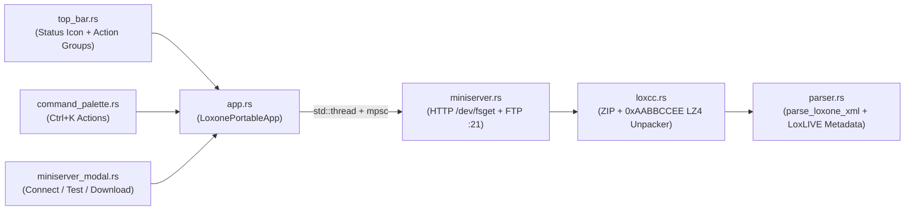

# Loxone Portable — Phase 2: Miniserver Connection, Status Indicator, Extensible Top Bar & Project Download Design Specification

**Date:** 2026-10-15
**Status:** Approved
**Target Workspace:** `/Users/bartlomiej.klimczak/Projects/loxone-portable`

---

## 1. Overview & Goals

Add the ability to connect directly to a Loxone Miniserver (Gen 1 or Gen 2) over the local network, verify connection status with a persistent visual status icon, list and download `.LoxCC` / `.zip` project backups from `/prog/`, decompress them in memory into `.Loxone` XML, open them immediately in the schematic viewer, and optionally save the decompressed `.Loxone` XML to disk.

Simultaneously, refactor the top header bar into a dedicated, extensible `top_bar.rs` module built around declarative toolbar groups (`File`, `Miniserver & Tools`, `Command Pill`, `View`) so future Miniserver and project tools (`Upload`, `Live Monitor`, `Simulator`, `Config Diff`) integrate cleanly without cluttering `app.rs`.

---

## 2. Architecture & Module Responsibilities

### 2.1 `crates/loxone-core`
1. **`model.rs` & `parser.rs` — `LoxLIVE` Metadata & Raw XML Retention**
   - Extend `ProjectMetadata` with:
     - `pub miniserver_ip: Option<String>` (`IntAddr` from `<C Type="LoxLIVE">`, e.g. `"192.168.1.100"` in `Klimczaki.Loxone`)
     - `pub miniserver_serial: Option<String>` (`Serial` from `<C Type="LoxLIVE">`, e.g. `"504F94A0ECAD"`)
     - `pub miniserver_hostname: Option<String>` (`HoN` from `<C Type="LoxLIVE">`, e.g. `"miniserwer"`)
   - Extend `LoxoneProject` with `pub raw_xml: Option<String>` so any loaded or downloaded project can be saved to disk as a `.Loxone` XML file.

2. **`loxcc.rs` — `.LoxCC` Binary Decompression & Backup ZIP Extraction**
   - **`decompress_loxcc(data: &[u8]) -> Result<String, LoxCcError>`**:
     - Pass-through support if `data` already begins with UTF-8 BOM `\u{FEFF}`, `<?xml`, or `<ControlList`.
     - Parses the 16-byte LoxCC header (`0xAABBCCEE` magic `u32_le`, `compressed_size: u32_le`, `uncompressed_size: u32_le`, `checksum: u32_le`).
     - Executes the Loxone LZ4-style block decompression loop (token byte split into `lit_len` high nibble and `match_nibble` low nibble, extended length bytes while `== 255`, literal copy, `u16_le` back-reference offset, and byte-by-byte match copy supporting overlapping RLE runs).
   - **`extract_loxone_xml(bytes: &[u8]) -> Result<String, LoxCcError>`**:
     - Detects ZIP archives (`PK\x03\x04`), prioritizes `sps0.LoxCC` (or any `.LoxCC` / `.Loxone` entry inside the ZIP), reads its bytes, and decompresses via `decompress_loxcc`.
   - **`compress_loxcc_literals(raw: &[u8]) -> Vec<u8>`**:
     - Encodes uncompressed XML/bytes into a valid `0xAABBCCEE` `.LoxCC` stream for deterministic round-trip testing.

3. **`miniserver.rs` — Connection Status, Snapshot Listing, Profile Persistence & Dual-Transport Client**
   - **`ConnectionStatus` Enum**:
     - `Disconnected`
     - `Connecting { host: String, message: String }`
     - `Connected { host: String, server_info: String }`
     - `Error { host: String, error: String }`
   - **`BackupSnapshot` & `parse_prog_listing(listing: &str) -> Vec<BackupSnapshot>`**:
     - Parses `/dev/fslist/prog` HTTP responses and FTP directory listings for `sps_<version>_<YYYYMMDDHHMMSS>.zip`, `sps_new.zip`, and `sps0.LoxCC`.
     - Formats `YYYYMMDDHHMMSS` into `YYYY-MM-DD HH:MM:SS` and sorts newest snapshots first.
   - **`ConnectionProfile`**:
     - Persists `host`, `username`, `remember_password`, and optional `password` to `~/.config/loxone-portable/connection.json` (omitting `password` when `remember_password` is `false`).
   - **`MiniserverClient`**:
     - Supports HTTP/HTTPS (`GET /dev/fslist/prog` and `GET /dev/fsget/prog/<filename>` with HTTP Basic Auth) and FTP fallback (`<host>:21` `/prog/`).
     - Provides `check_connection`, `list_snapshots`, and `download_snapshot_xml`.

### 2.2 `crates/loxone-gui`
1. **`theme.rs` — Status Indicator Colors**
   - Add semantic connection status colors matching the dark palette:
     - `STATUS_DISCONNECTED`: `#8B95A7` (`TEXT_MUTED`)
     - `STATUS_CONNECTING`: `#F59E0B` (Amber)
     - `STATUS_CONNECTED`: `#3ECF8E` (Emerald Green)
     - `STATUS_ERROR`: `#E5534B` (Crimson Red)

2. **`top_bar.rs` — Extensible Declarative Top Action Bar & Connection Status Icon**
   - Replaces the inline top panel in `app.rs` with structured toolbar sections:
     - **Workspace & Breadcrumb**: Sidebar toggle `☰`, Project title / active page breadcrumb.
     - **`File` Group**: `Open… (Ctrl+O)`, `Save .Loxone… (Ctrl+S)` (enabled whenever `project.raw_xml` is available).
     - **`Miniserver & Tools` Group**:
       - **Connection Status Pill**: Renders a custom painted status icon (`○` gray when Disconnected, `◐` amber when Connecting/Downloading, `●` green with subtle glow ring when Connected, `●` red when Error) alongside the status label (`Disconnected`, `Connecting…`, `Connected · 192.168.1.100`, or `Error · 192.168.1.100`) and detailed hover tooltip. Clicking opens the Miniserver Connection modal.
       - **Extensible Action Strip**: Renders declarative `ToolbarItem` actions starting with `⬇ Download` (`Ctrl+Shift+D`) and structured so future Miniserver tools drop into `build_miniserver_toolbar_items()`.
     - **Command Palette Pill**: `🔍 Search or jump… ⌘K / Ctrl+K`.
     - **`View` Group**: Zoom readout, `Pins (P)`, `Fit (F)`, and Inspector toggle `ℹ (Ctrl+I)`.

3. **`miniserver_modal.rs` — Miniserver Connection & Backup Browser Modal**
   - Displays the live **Connection Status Icon + Badge** in the modal header.
   - Pre-fills `host` from saved `ConnectionProfile` or the currently loaded project's `<C Type="LoxLIVE" IntAddr="...">`.
   - Provides **`Test Connection`**, **`Download Latest`** (primary action), and an expandable **`Browse Backups…`** list showing historical snapshots in `/prog/` with individual **`Download`** buttons.
   - Runs network operations on a background `std::thread` via `std::sync::mpsc` so the `egui` UI never blocks.

4. **`command_palette.rs` & `app.rs` Integration**
   - Adds `PaletteAction::ConnectMiniserver` (`Connect to Miniserver / Download Project…`, `Ctrl+Shift+D`) and `PaletteAction::SaveFile` (`Save Project as .Loxone File…`, `Ctrl+S`).
   - Polls background worker messages every frame in `LoxonePortableApp::update`, updating `ConnectionStatus`, snapshot list, or active `LoxoneProject`.

---

## 3. Testing & Verification Strategy

- **Unit Tests (`loxone-core`)**:
  - Verify `Klimczaki.Loxone` extracts `miniserver_ip == Some("192.168.1.100")`, `miniserver_serial == Some("504F94A0ECAD")`, `miniserver_hostname == Some("miniserwer")`, and retains `raw_xml`.
  - Verify `loxcc::decompress_loxcc` and `loxcc::extract_loxone_xml` with both literal and back-reference LZ4 sequences and ZIP-wrapped `sps0.LoxCC` archives.
  - Verify `miniserver::parse_prog_listing`, `ConnectionProfile` JSON persistence (with password stripping when `remember_password == false`), and end-to-end `MiniserverClient` `check_connection`, `list_snapshots`, and `download_snapshot_xml` against a local ephemeral TCP mock HTTP server serving `/dev/fslist/prog` and `/dev/fsget/prog/sps_194_20260308182256.zip`.
- **GUI Tests (`loxone-gui`)**:
  - Verify `top_bar` status indicator metadata and declarative toolbar groups across all 4 `ConnectionStatus` states (`Disconnected`, `Connecting`, `Connected`, `Error`).
  - Verify headless `egui::Context::run` rendering of `top_bar` and `miniserver_modal`, plus `PaletteAction::ConnectMiniserver` and `PaletteAction::SaveFile` integration in `app.rs`.
